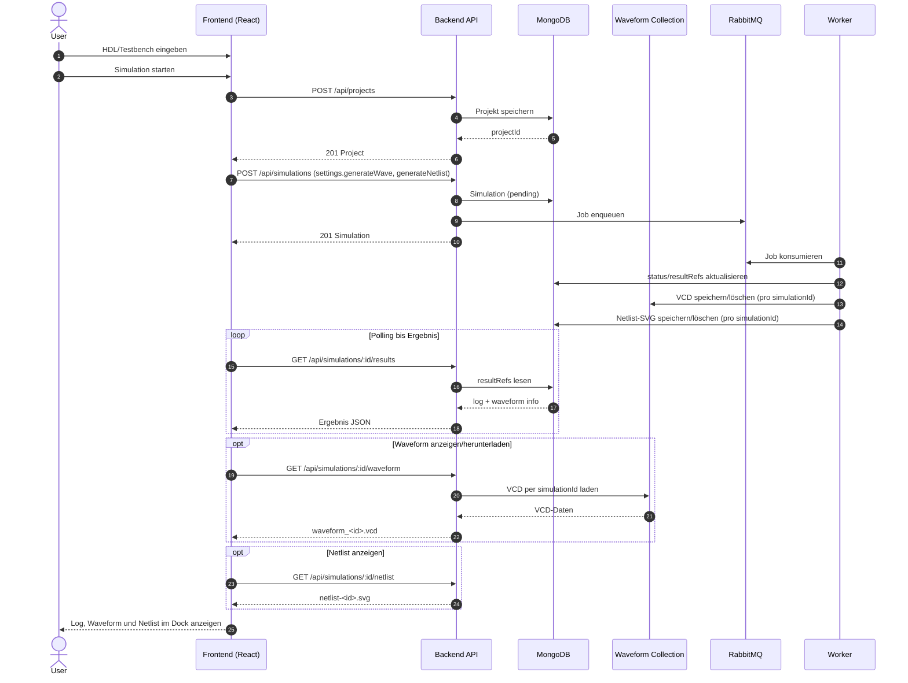
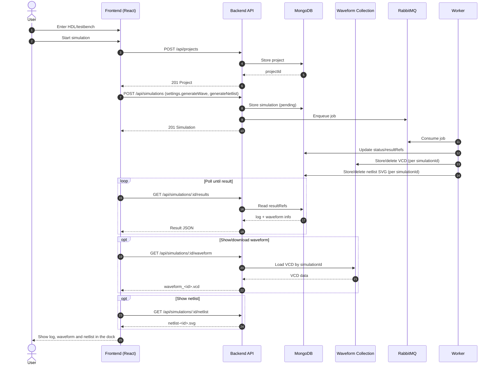

# HDLab Frontend Dokumentation

Diese README dokumentiert das Frontend im Ordner `apps/frontend` im aktuellen Ist-Zustand.

## 1. Zweck des Frontends

Das Frontend ist die Benutzeroberfläche für HDLab und bietet:

- Browserbasiertes Editieren von HDL-Code (Monaco Editor)
- Optionalen Testbench-Editor (SystemVerilog oder Python)
- Mehrere Projekte als Editor-Tabs (umbenennbar, persistent in `localStorage`)
- Starten von Simulationen über die Backend-API - **parallel pro Projekt**, mit Statusanzeige im Tab
- Anzeige der Simulationslogs als Kurzfassung, Details per "Details anzeigen" aufklappbar
- Workbench-Layout mit Dock unten (Reiter Ausgabe / Waveform / Netlist), Editorbreite und Dockhöhe per Ziehen anpassbar
- Waveform-Viewer pro Projekt (Zeitlineal, Cursor, Filter, Zoom, Hex/Dez/Bin, Signale ausblenden, VCD-Download)
- Netlist-Ansicht: Schaltplan des Designs als SVG mit Zoom, Verschieben und Download
- Eigene URLs für Editor, Tutorial, Kurse und Lektionen (Browser-Pfeile, Reload, Links)
- Interaktives Verilog-Tutorial und Kurse aus dem Topbar-Menü "Lehre"
- Vollbildmodus für Code-/Testbench-Editoren und Tutorial-Codeblöcke
- Upload/Download von Design- und Testbench-Dateien
- Sprachumschaltung der UI (Deutsch/Englisch)
- Erweiterte Cocotb-Beispiele mit ausführlichen Testausgaben (`cocotb.log.info`)

## 2. Tech-Stack

### Sprachen

- JavaScript (React mit JSX)
- CSS

### Frameworks & Libraries

- React 18 (`react`, `react-dom`)
- Vite 8 als Dev-Server und Build-Tool (Upgrade auf 8.3.1 im September 2026 wegen esbuild-Dev-Server-Schwachstelle)
- `@vitejs/plugin-react-swc` für React + Fast Refresh
- Monaco Editor Integration via `@monaco-editor/react`
- ZIP-Erzeugung via `jszip`
- Syntax-Highlighting der Tutorial-Codebeispiele via `react-syntax-highlighter` (Prism, nur Verilog-Grammatik registriert)

### Build/Lint

- ESLint + React/React Hooks Plugins

## 3. Laufzeitarchitektur

### UML-Sequenzdiagramm (Frontend-Flow)



### Komponentenstruktur

- `src/main.jsx`: App-Bootstrap und Warnung bei fehlendem `VITE_API_URL`
- `src/App.jsx`: Hauptlogik (Projekte, Editoren, Dateioperationen, Simulationsstart/-polling pro Projekt, Seitenwahl über `useRoute`)
- `src/hooks/useRoute.js`: hält die aktuelle Seite synchron mit der Browser-URL (ohne Router-Bibliothek), siehe "URLs und Navigation"
- `src/config/courses.js`: Kursliste für das Lehre-Menü
- `src/components/EditorTabs.jsx`: Projekt-Tabs (Umbenennen per Stift-Icon/Doppelklick, Schließen mit Bestätigung, Simulationsstatus je Tab)
- `src/components/SimulationPanel.jsx`: Run-Button und Dock des aktiven Projekts (Ausgabe, Waveform, Netlist)
- `src/components/BottomDock.jsx`: einklappbares Dock mit Reitern, Höhe per Ziehen (gespeichert unter `hdlab-dock-height`); alle Reiter bleiben gemountet, damit z.B. der Waveform-Zoom beim Umschalten erhalten bleibt
- `src/components/WaveformViewer.jsx`: Waveform-Viewer (Einzelbits als Linien, Busse als Wertboxen, Zeitlineal, Cursor mit Werten, Filter, Zoom, Verschieben, "Gehe zu Zeit", Hex/Dez/Bin pro Signal, Signale aus-/einblenden, VCD-Download)
- `src/components/NetlistViewer.jsx`: Schaltplan-Ansicht mit Zoom, Verschieben und SVG-Download
- `src/hooks/useSimArtifacts.js`: lädt VCD und Netlist einer fertigen Simulation per `apiCall()` (das SVG wird als Object-URL in ein `` gesetzt, damit es keine Skripte ausführen kann)
- `src/hooks/useDragSize.js`: per Ziehen veränderbare Größen mit Speicherung in `localStorage`
- `src/components/FullscreenPanel.jsx`: Wrapper, der Editoren/Codeblöcke auf Vollbild vergrößert (Esc beendet)
- `src/utils/simState.js`: Default-Simulationszustand je Projekt (`EMPTY_SIM`)
- `src/utils/vcd.js`: VCD-Parsing (Timescale, Deklarationsreihenfolge, gleichnamige Signale über Hierarchieebenen nur einmal)
- `src/components/Sidebar.jsx`: Optionen, Dateiaktionen, Code-Beispiele (mit Bestätigungsabfrage vor dem Laden)
- `src/components/Topbar.jsx`: Topbar-Aktionen (Editor, Tutorial, Lehre-Menü, Module, Hilfe, Einstellungen), Sprachumschaltung, Profil-Dropdown, Drawer der Modul-Bibliothek
- `src/components/Auth.jsx`: Login (inkl. Button "Mit HTWK-GitLab anmelden"), Registrierung, "Passwort vergessen"
- `src/contexts/AuthContext.jsx`: JWT-Auth-State, `apiCall()`-Helper, `hasRole()`-Gruppenprüfung, GitLab-Login
- `src/components/ModuleLibrary.jsx`: Modul-Bibliothek (im Drawer über den Topbar-Button "Module")
- `src/components/TutorialContainer.jsx`, `TutorialOverview.jsx`, `TutorialLesson.jsx`, `LessonNav.jsx`: Tutorial-System (siehe 5.1)
- `src/utils/tutorialParser.js`, `tutorialLoader.js`: Markdown-Parsing für das Tutorial
- `src/App.css`, `src/index.css`, `src/components/Workbench.css`: Styling

## 4. API-Nutzung durch das Frontend

Die zentrale Simulationslogik liegt in `runSimulation()` in `src/App.jsx`.

Alle Aufrufe laufen über `apiCall()` aus `AuthContext` und schicken damit `Authorization: Bearer <token>` mit - das Backend verlangt für diese Endpunkte seit September 2026 einen Login und liefert nur eigene Projekte/Simulationen (siehe Backend-README Abschnitt 8). Fehlerantworten beim Anlegen von Projekt/Simulation werden in der Konsole angezeigt.

Verwendete Endpunkte:

1. `POST /api/projects`
2. `POST /api/simulations`
3. `GET /api/simulations/:id/results` (Polling im 1s-Intervall, bis `status` `finished`/`error` ist, max. 5 Minuten; liefert `hasWaveform` und `hasNetlist`)
4. `GET /api/simulations/:id/waveform` (optional, wenn Waveform vorhanden; von `useSimArtifacts.js` per `apiCall` als Text geladen - der VCD-Download im Viewer speichert diesen Text als Blob, weil ein einfacher Link keinen Auth-Header mitschicken kann)
5. `GET /api/simulations/:id/netlist` (optional, wenn `hasNetlist`; ebenfalls über `useSimArtifacts.js`, als Object-URL in einem `` angezeigt)
6. Tutorial: `POST /api/tutorial/validate`, `GET/POST /api/tutorial/progress[/:lessonId]` (mit `?course=<id>` in Kursen), Modul-Bibliothek `/api/modules`

Typischer Request für Projektanlage:

```json
{
	"name": "Playground",
	"files": [
		{
			"filename": "main.sv",
			"content": "...",
			"language": "systemverilog"
		},
		{
			"filename": "tb.sv",
			"content": "...",
			"language": "systemverilog"
		}
	]
}
```

Typischer Request für Simulationsstart:

```json
{
	"projectId": "<mongo-object-id>",
	"language": "systemverilog",
	"testbenchType": "systemverilog",
	"settings": { "generateWave": true, "generateNetlist": true }
}
```

Der Editor fordert die Netlist immer an (`generateNetlist: true`), die Waveform nur bei aktivierter Waveform-Option.

## 5. Dateifunktionen im Frontend

### Download

- Nur eine Design-Datei ohne Testbench: Download der Top-Datei (z. B. `main.sv`)
- Sonst: Download als `hdl_project.zip` mit allen Design-Dateien in ihrer Ordnerstruktur und `tb.sv` oder `tb.py`

### Upload

- Design-Datei: erlaubt `.sv` oder `.txt`
- Testbench-Datei: erlaubt `.sv`, `.py` oder `.txt`
- Falsche Endungen werden clientseitig blockiert
- Bei jedem Klick auf ein Code-Beispiel in der Sidebar (unabhängig vom aktuellen Editor-Inhalt) sowie beim Klick auf das HDLab-Logo/Home mit ungespeicherten Änderungen fragt eine `window.confirm()`-Dialog vor dem Überschreiben nach

## 5.1 Tutorial-System

Das Frontend enthält ein umfassendes interaktives Tutorial-System zum Erlernen von (System)Verilog, aktuell knapp 90 Lektionen (Stand: `VerilogTutorialFormatted.md`), organisiert in einer Einführung plus 11 Kapiteln (Kapitel 0 - Kapitel 10), jeweils mit mehreren Unterkapiteln.

### Tutorial-Komponenten

**TutorialContainer.jsx** - Lädt das Markdown aus `tutorialPath` via `parseTutorialFromFile()` (Verilog-Tutorial: `/Tutorial/VerilogTutorialFormatted.md`; Kurse: `tutorialPath` aus `config/courses.js`, z.B. `/Kurse/ES1/ES1Tutorial.md`, jeweils statisch aus `apps/frontend/public/` ausgeliefert). Ansicht und aktuelle Lektion kommen aus der URL (`routeLesson`), nicht aus eigenem State. Ohne gültige Lektion in der URL wird auf die zuletzt besuchte (`localStorage`-Key `hdlab-tutorial-last-lesson-<courseId|verilog>`) bzw. erste Lektion weitergeleitet. Rendert links den Lektionsbaum (`LessonNav`) und daneben `TutorialOverview` oder `TutorialLesson`. Für Kurse wird zusätzlich `courseId` durchgereicht, damit der Fortschritt getrennt gespeichert wird.

**LessonNav.jsx** - Scrollbarer Lektionsbaum links: ausklappbare Kapitel, Theorie/Übung farblich unterschieden (Badges T/Ü), Haken für gelöste Übungen, Fortschrittszähler pro Kapitel, Link zur Übersicht. Auf schmalen Bildschirmen als ausklappbare Navigation.

**TutorialOverview.jsx** - Landing Page mit drei umschaltbaren Ansichten (Nach Kapitel / Nach Schwierigkeit / Nach Aufgabentyp):
- **Kapitel-Ansicht** (Standard): Jedes Kapitel (Einführung, Kapitel 0-10) ist ein aufklappbares Dropdown. Pro Kapitel werden maximal 7 Unterkapitel angezeigt, darüber hinaus blendet ein "Mehr anzeigen"-Button die restlichen ein
- Jede Lerneinheit zeigt ein Typ-Badge (📖 Theorie / ✏️ Übung / 🚀 Projekt)
- "Von vorne beginnen"-Button springt zur ersten Lektion

**TutorialLesson.jsx** - Hauptkomponente für einzelne Lektionen:
- Zeigt Markdown-formatierte Erklärungen (via `react-markdown` mit `remark-gfm` und `rehype-raw`, siehe unten)
- Unterstützt drei Lektionstypen: `theory` (nur Erklärung), `exercise` (mit Editor, Testbench, Validierung), `project`
- **Layout** (seit Oktober 2026): Lektion in der Mitte, Editor rechts (Breite per Ziehen, gespeichert unter `hdlab-tutorial-editor-width`), darunter das Dock mit Ausgabe/Waveform/Netlist. Theorie-Lektionen ohne Übung zeigen weder Editor noch Dock. Der Lektionskopf (Titel, Typ, Vor/Zurück-Pfeile) bleibt auf dem Desktop beim Scrollen oben angepinnt
- **Dock**: startet für Studierende zugeklappt, für `admin`/`developer` aufgeklappt; bei fehlgeschlagener Einreichung öffnet es sich, damit die Fehlermeldung sichtbar ist. Waveform und Netlist der Validierungs-Simulation werden über die zurückgegebene `simulationId` nachgeladen
- **Tipps**: Gibt es in der Lektion `**HINT_START**`/`**HINT_END**`-Blöcke, deckt "💡 Tipp anzeigen" sie unter dem Lektionstext einzeln nacheinander auf ("Tipp 1/3", ...), "Tipps verbergen" klappt sie wieder zu
- Code-Editor mit **Reset-Button**: Setzt Editor-Inhalt (Code + Testbench) zurück auf den Ausgangszustand der Übung (mit Bestätigungsabfrage), ohne den Backend-Fortschritt oder Validierungsstatus anzufassen
- **Testbench-Editor ist read-only** (`options={{ readOnly: true }}`) - kann nur angezeigt/ausgeblendet, nicht bearbeitet werden
- "Testbench anzeigen" und "Lösung anzeigen" stehen in der Fußzeile unter dem Editor neben "▶ Lösung einreichen"; der Inhalt klappt zwischen Editor und Fußzeile auf
- **Musterlösung** nur nach Passwortabfrage sichtbar (eigener Dialog mit verdeckter Eingabe, Augen-Icon zeigt das Passwort solange gedrückt gehalten, Fehlermeldung im Dialog; Vergleichswert aus `VITE_TUTORIAL_SOLUTION_PASSWORD`, Fallback `'verilog'`) - Nutzer mit Rolle `admin` oder `developer` (`hasRole()` aus `AuthContext`) überspringen die Abfrage automatisch. **Kein echter Zugriffsschutz**: Die Lösung ist ohnehin Teil des an jeden eingeloggten Nutzer ausgelieferten Lesson-JSON
- Vor/Zurück-Pfeile neben dem Lektionstitel sowie "Vorherige Lektion" / "Nächste Lektion" am Ende: **kein Sperren mehr** bei nicht bestandener Übung - stattdessen zeigt ein Status-Marker zwischen den beiden Buttons "✓ Abgeschlossen" oder "○ Nicht abgeschlossen" (nur bei `type === 'exercise'`)
- **Interne Anker-Links im Markdown** (z.B. `[0.1 Was ist Verilog?](#01-was-ist-verilog)` im Inhaltsverzeichnis) werden über einen eigenen `a`-Renderer in `ReactMarkdown` abgefangen: `handleContentLinkClick()` schlägt den Anker in der von `tutorialParser.js` gelieferten `anchorMap` nach und navigiert per `onNavigateToLesson` (aus `TutorialContainer.jsx`) direkt zur passenden Lektion, statt (wirkungslos) auf der aktuellen Lektionsseite zu scrollen. Externe Links (`http://`, `https://`) sind davon nicht betroffen

**tutorialParser.js** - Utility für Markdown-Parsing:
- `parseTutorialFromMarkdown()`: Zeilenbasierte Iteration über `<!-- lesson_id: ... -->`-HTML-Kommentarblöcke als Frontmatter
- `parseTutorialFromFile()`: lädt und parst per `fetch()`
- Gibt zurück: `lessons` (Map), `lessonIds` (Dokumentreihenfolge), `byDifficulty`, `bySection`, `byType`, `byChapter` (Array `{key, lessonIds}[]`, Gruppierung anhand der Nummerierung im Lektionstitel - `key: 'intro'` für Vorwort/Inhaltsverzeichnis, sonst die Kapitelnummer als String), **`anchorMap`** (Map von Anchor-Slug zu `lesson_id`, siehe unten)
- Entfernt die führende Markdown-Überschrift aus der Erklärung (`explanation`/`description`), da der Titel bereits separat über `lesson.title` angezeigt wird
- `slugify()` leitet aus jeder Kapitelüberschrift (vor deren Entfernung aus dem Body) einen GitHub-kompatiblen Anchor-Slug ab (z.B. "0.1 Was ist Verilog?" → `01-was-ist-verilog`); `buildAnchorMap()` sammelt diese Slugs pro Lektion in `anchorMap`, mit `-1`/`-2`-Suffix bei Duplikaten (wie bei GitHub-Ankern)
- Seit Oktober 2026 landen auch **Zwischenüberschriften** einer Lektion in `anchorMap` (`lesson.headingAnchors`, durchgezählt wie bei GitHub, z.B. `schnittstelle-1`, `-2`): ein Link darauf öffnet die Lektion und springt zum Abschnitt
- Extrahiert **Tipps** (`**HINT_START**` ... `**HINT_END**`, beliebig viele pro Lektion) als Markdown nach `lesson.hints` und entfernt sie aus dem Lektionstext

**Tutorial.css** - Styling für Tutorial-Komponenten:
- Markdown-Element-Styling: `h1`-`h6`, `code`, `pre` (heller Codeblock-Hintergrund, passend zum übrigen Light-Mode-Design), `table`/`th`/`td`, `ul`/`ol`
- Status-Marker (`.lesson-status-marker.completed` / `.not-completed`), Reset-Button (`.btn-reset`), Chapter-Dropdown (`.difficulty-group`, wiederverwendet aus der Schwierigkeits-Ansicht)

### HTML- und Tabellen-Rendering im Markdown

`react-markdown` rendert standardmäßig **kein** rohes HTML und **keine** GFM-Tabellen (Pipe-Syntax). Beides ist inzwischen aktiviert:

- `remark-gfm`: aktiviert GitHub-Flavored-Markdown-Tabellen (`| A | B |`)
- `rehype-raw`: aktiviert rohe HTML-Blöcke (z.B. `<div style="display:flex">...</div>`) direkt im Tutorial-Markdown

Beides ist unbedenklich, weil der Markdown-Inhalt aus einer statischen, projekteigenen Datei kommt (kein Nutzer-Input) - `rehype-raw` sollte **nicht** auf nutzergenerierten Inhalt angewendet werden, ohne diesen vorher zu sanitizen.

### Navigation über Inhaltsverzeichnis-Links (August 2026)

Jede Lektion wird als eigene "Seite" gerendert (State-Wechsel in `TutorialContainer.jsx`, kein durchgängig gescrolltes Dokument). Anker-Links wie `#01-was-ist-verilog` aus der Lektion "Inhaltsverzeichnis" liefen deshalb vorher ins Leere, weil das Ziel-Element (die Überschrift der Ziel-Lektion) gar nicht im DOM der aktuellen Seite existiert.

Lösung:
1. `tutorialParser.js` berechnet beim Parsen für jede Lektion aus deren Kapitelüberschrift einen GitHub-kompatiblen Anchor-Slug (`slugify()`) und baut daraus eine globale `anchorMap: { [slug]: lessonId }` (`buildAnchorMap()`).
2. `TutorialContainer.jsx` reicht `anchorMap` sowie den bestehenden `handleStartLesson`-Handler (als Prop `onNavigateToLesson`) an `TutorialLesson.jsx` durch.
3. `TutorialLesson.jsx` fängt Klicks auf `#`-Links im gerenderten Markdown per eigenem `a`-Component in `ReactMarkdown` ab, löst den Anker in `anchorMap` auf und springt direkt zur Ziel-Lektion (bei Zwischenüberschriften zusätzlich zum Abschnitt).

Seit Oktober 2026 hat jede Lektion eine eigene URL (siehe "URLs und Navigation"), der Lektionswechsel läuft also über die URL statt über reinen State.

Das funktioniert automatisch für **neue** Lektionen, sobald deren Überschrift und ein passender Link (z.B. im Inhaltsverzeichnis) existieren - der Slug wird zur Laufzeit aus der Überschrift berechnet, nicht hart codiert. Manuell bleibt: Ein neuer TOC-Eintrag muss weiterhin von Hand in die Inhaltsverzeichnis-Lektion eingetragen werden, das Verzeichnis wird nicht automatisch generiert.

### Validierungsablauf (für Exercise-Lektionen)

Wenn Benutzer „Lösung einreichen" drückt (`handleValidate()` in `TutorialLesson.jsx`):

1. Frontend sendet `{ lessonId, moduleCode, testbench }` an `POST /api/tutorial/validate` (authentifiziert)
2. Backend instrumentiert die Testbench, legt intern ein Projekt + eine Simulation an und pollt bis zu 30 Sekunden auf ein Ergebnis (Details siehe Backend-README, Abschnitt 8.5)
3. Response wird angezeigt:
   - ✓ **passed**: "✓ Richtig gelöst!" (ggf. + Hinweis, dass die Lösung automatisch als Modul gespeichert wurde)
   - ✗ **failed**: "✗ Nicht korrekt" + relevante Fehler-/Warnungszeilen aus dem Simulationslog
   - In beiden Fällen: aufklappbares Panel "Vollständige Ausgabe anzeigen" mit dem kompletten Log (`fullLog`, seit September 2026)
   - Seit Oktober 2026 enthält die Antwort `simulationId`, `hasWaveform`, `hasNetlist`; Waveform und Netlist erscheinen im Dock. Bei Fehlschlag klappt das Dock auf
4. Bei Erfolg wird der Code zusätzlich automatisch in der Modul-Bibliothek gespeichert (siehe Abschnitt 15)

### URLs und Navigation (Oktober 2026)

`src/hooks/useRoute.js` leitet die aktuelle Seite aus `window.location.pathname` ab (ohne Router-Bibliothek, über `history.pushState`/`replaceState` und `popstate`) und gibt `[route, navigate]` zurück:

| URL | Seite |
|---|---|
| `/Editor` | Editor |
| `/Tutorial`, `/Tutorial/<lesson_id>`, `/Tutorial/Uebersicht` | Verilog-Tutorial |
| `/Lehre/<id>`, `/Lehre/<id>/<lesson_id>`, `/Lehre/<id>/Uebersicht` | Kurs aus `config/courses.js` |

- Groß-/Kleinschreibung ist egal; `/`, unbekannte Pfade und andere Schreibweisen werden ohne zusätzlichen Verlaufseintrag auf die kanonische URL umgeschrieben (`/` → `/Editor`)
- Ohne (gültige) Lektion leitet `TutorialContainer` ohne Verlaufseintrag auf die zuletzt geöffnete bzw. erste Lektion weiter
- Browser-Pfeile wechseln zwischen Seiten und Lektionen, ein Reload bleibt auf der aktuellen Seite, Lektionen sind verlinkbar
- Der Vite-Dev-Server liefert für diese Pfade `index.html` aus (SPA-Fallback), nginx reicht sie an den Frontend-Container durch

### Bedingte UI-Rendering (lesson.type)

```jsx
// Nur für Exercise-Lektionen sichtbar:
{lesson.type === 'exercise' && (
  <>
    {/* Testbench-Editor (read-only) */}
    {/* Reset-Button */}
    {/* "Lösung einreichen"-Button */}
    {/* Validierungs-Ergebnis + Status-Marker */}
  </>
)}

// Theory-Lektionen zeigen nur die Erklärung, keine Editoren
```

## 6. Konfiguration und Umgebungsvariablen

### Relevante Variablen

- `FRONTEND_PORT` (Compose Host-Port, Standard 5173)
- `VITE_API_URL` (Warnhinweis in `main.jsx`, aber im Compose-Setup wird primär Proxy genutzt)
- `VITE_TUTORIAL_SOLUTION_PASSWORD` (optional, Fallback `'verilog'`) - Passwort für die Musterlösungsanzeige im Tutorial
- `authToken` in `localStorage` hält die Login-Session zwischen Reloads

> **Wichtig:** Der `frontend`-Service in `docker-compose.yml` hat `env_file: .env.runtime`, damit `VITE_*`-Variablen aus der generierten `.env.runtime` (siehe `setup.sh`) in den Vite-Dev-Server-Prozess gelangen (Vite spiegelt `VITE_`-präfixte Prozessvariablen automatisch nach `import.meta.env`). Dabei ist zusätzlich `NODE_ENV=development` explizit als `environment:`-Override gesetzt, der `.env.runtime` überschreibt: Der Frontend-Container läuft **immer** über `npm run dev` (Vite-Dev-Server), nie über einen Production-Build. Würde `NODE_ENV=production` aus `.env.runtime` (Server-Modus) durchschlagen, liefert Reacts `react/jsx-dev-runtime` keine `jsxDEV`-Funktion mehr aus, und die App crasht beim ersten Render mit `TypeError: _jsxDEV is not a function` (weißer Bildschirm). Bei Änderungen an `docker-compose.yml` rund um den `frontend`-Service diesen Override nicht versehentlich entfernen.

### Vite Proxy

In `vite.config.js` ist konfiguriert:

- `/api` -> `http://backend:3001`

Damit können API-Calls im Frontend relativ (`/api/...`) erfolgen.

### Auth Flow Hinweis

- Login und Registrierung speichern den JWT direkt in `localStorage`
- Nach erfolgreichem Login/Register wechselt die App ohne manuellen Reload in den Editor
- Ein weißer Screen nach Login/Logout ist ein Fehler im Render-Flow und kein gewünschtes Verhalten

## 8. Ports

- Frontend Container-Port: `5173` (siehe `apps/frontend/Dockerfile`)
- Compose Mapping: `${FRONTEND_PORT:-5173}:5173`
- Backend-Ziel aus Frontend-Sicht im Compose-Netz: `backend:3001`

## 9. Start und Entwicklung

Im Frontend-Ordner:

```bash
cd apps/frontend
npm install
npm run dev
```

Weitere Scripts:

- `npm run build` (Production Build)
- `npm run preview` (Build Preview)
- `npm run lint` (ESLint)

## 10. Zustandsmodell der UI (vereinfacht)

Wichtige States in `App.jsx` (Stand September 2026):

- `projects` (persistent in `localStorage` unter `hdlab-projects`): Liste von `{ id, name, code, testbench, language, testbenchLang, testbenchEnabled, wave }`
- `activeProjectId` (persistent unter `hdlab-active-project`) - das aktive Projekt ist die **einzige Quelle** für die Editorinhalte (`code`, `testbench`, ... werden daraus abgeleitet, nicht separat gespiegelt)
- `simStates`: Simulationszustand **pro Projekt-ID** (bewusst nicht persistiert), je Eintrag wie `EMPTY_SIM` in `utils/simState.js`:
  - `status` (`idle` | `running` | `finished` | `error`), `runId`, `simulationId`
  - `logSummary`, `logDetails`
  - `hasWaveform`, `hasNetlist` (seit Oktober 2026; VCD und SVG lädt `SimulationPanel` über `useSimArtifacts` nach, die früheren Felder `waveformPreview`, `waveformViewMode`, `waveZoom`, ... gibt es nicht mehr)
- `helpOpen`, `settingsOpen`, `themeMode` (persistent unter `hdlab-theme`)
- `uiLanguage`
- `currentPage` (`home` | `tutorial` | `course`), `activeCourseId`, `routeLesson`: kein State mehr, sondern aus der URL über `useRoute()` abgeleitet (seit Oktober 2026)
- `moduleLibraryOpen` (Drawer der Modul-Bibliothek)

Die frühere Umschaltung `logViewMode` (`compact` | `full`) wurde entfernt.

## 11. Neuerungen (April 2026)

- Neue Cocotb-Beispiele in der Sidebar (u. a. ALU, Komparator, synchroner Zähler)
- Verbose Test-Logs in Python-Beispielen für bessere Nachvollziehbarkeit pro Testvektor
- Log-Umschalter in der Ergebnisanzeige: `Kompakt` / `Vollständig`
- Vollständig-Ansicht zeigt nur relevanten Cocotb-Test-Output statt kompletter Build-Ausgabe
- Waveform-Features: Download, Rohansicht und Signalansicht direkt im Frontend
- Signalansicht mit Zoom, Signal-Checkboxen je Spur, Bus-Hex-Labels und farbcodierten Flanken
- Topbar-Hilfe mit Funktionsübersicht und Signal-Farbcode-Legende
- Einstellungen-Dialog mit Light/Dark-Mode inkl. persistenter Speicherung (`localStorage`)
- Tutorial-System mit progressiven Lektionen, damals initial ~23 (Stand April 2026; mittlerweile knapp 90 Lektionen in Kapiteln, siehe Abschnitt 5.1 und "20. Neuerungen (Juli 2026)")
- Interaktive Code-Validierung mit automatischer Testbench-Generierung
- Markdown-basierte Lektionen mit react-markdown Rendering
- Bedingte UI für Exercise vs. Theory Lektionen
- State-Reset bei Lektionswechsel (Benutzercode, Validierungsstatus)

## 12. Bekannte Grenzen (aktueller Stand)

- Polling statt WebSocket: Simulationen werden gepollt, bis `status` `finished`/`error` ist (max. 5 Minuten); die Tutorial-Validierung wartet backendseitig max. 30 Sekunden
- Fehlerbehandlung der API-Antworten ist bewusst einfach gehalten
- `VITE_API_URL` wird geprüft, aber Standardfluss nutzt den Vite-Proxy auf `/api`

## 13. Relevante Dateien

- `src/main.jsx` - App-Entry
- `src/App.jsx` - Kernlogik, API-Integration, Editor- und Dateiabläufe
- `src/components/Sidebar.jsx` - UI-Controls
- `src/components/Topbar.jsx` - Kopfbereich/UI-Aktionen
- `src/components/TutorialLesson.jsx` - Tutorial-Komponente mit Validierung
- `src/components/TutorialContainer.jsx`, `LessonNav.jsx` - Tutorial-/Kursseite mit Lektionsbaum
- `src/utils/tutorialParser.js` - Markdown-Parser für Lektionen
- `src/components/Tutorial.css`, `Workbench.css` - Tutorial-, Markdown- und Workbench-Styling
- `src/components/SimulationPanel.jsx`, `BottomDock.jsx`, `WaveformViewer.jsx`, `NetlistViewer.jsx` - Dock mit Ausgabe, Waveform und Netlist
- `src/hooks/useRoute.js` - URLs und Navigation
- `src/config/courses.js` - Kursliste (Lehre)
- `vite.config.js` - Dev-Proxy zum Backend
- `Dockerfile` - Containerstart für Frontend

---

# English Documentation

This README documents the frontend in `apps/frontend` as it currently exists.

## 1. Frontend Purpose

The frontend is HDLab's user interface and provides:

- Browser-based HDL editing (Monaco Editor)
- Optional testbench editor (SystemVerilog or Python)
- Multiple projects as editor tabs (renamable, persisted in `localStorage`)
- Simulation start through the backend API - **in parallel per project**, with status shown in the tab
- Simulation log shown as a short summary, details expandable via "Details anzeigen"
- Workbench layout with a dock at the bottom (tabs Output / Waveform / Netlist), editor width and dock height resizable by dragging
- Waveform viewer per project (time ruler, cursor, filter, zoom, hex/dec/bin, hide signals, VCD download)
- Netlist view: schematic of the design as SVG with zoom, pan and download
- Own URLs for editor, tutorial, courses and lessons (browser back/forward, reload, links)
- Interactive Verilog tutorial and courses from the "Lehre" topbar menu
- Fullscreen mode for code/testbench editors and tutorial code blocks
- Upload/download of design and testbench files
- UI language switch (German/English)
- Extended Cocotb examples with verbose test output (`cocotb.log.info`)

## 2. Tech Stack

### Languages

- JavaScript (React with JSX)
- CSS

### Frameworks & Libraries

- React 18 (`react`, `react-dom`)
- Vite 8 as dev server and build tool (upgraded to 8.3.1 in September 2026 to fix an esbuild dev-server vulnerability)
- `@vitejs/plugin-react-swc` for React + Fast Refresh
- Monaco integration via `@monaco-editor/react`
- ZIP generation via `jszip`
- Syntax highlighting for tutorial code examples via `react-syntax-highlighter` (Prism, only the Verilog grammar registered)

### Build/Lint

- ESLint + React/React Hooks plugins

## 3. Runtime Architecture

### UML Sequence Diagram (Frontend Flow)



### Component Structure

- `src/main.jsx`: app bootstrap and warning if `VITE_API_URL` is missing
- `src/App.jsx`: main logic (projects, editors, file operations, per-project simulation start/polling, page selection via `useRoute`)
- `src/hooks/useRoute.js`: keeps the current page in sync with the browser URL (no router library), see "URLs and Navigation"
- `src/config/courses.js`: course list for the "Lehre" menu
- `src/components/EditorTabs.jsx`: project tabs (rename via pencil icon/double-click, close with confirmation, per-tab simulation status)
- `src/components/SimulationPanel.jsx`: run button and dock of the active project (output, waveform, netlist)
- `src/components/BottomDock.jsx`: collapsible dock with tabs, height resizable by dragging (stored as `hdlab-dock-height`); all tabs stay mounted so e.g. the waveform zoom survives switching tabs
- `src/components/WaveformViewer.jsx`: waveform viewer (single bits as lines, buses as value boxes, time ruler, cursor with values, filter, zoom, pan, "go to time", hex/dec/bin per signal, hide/show signals, VCD download)
- `src/components/NetlistViewer.jsx`: schematic view with zoom, pan and SVG download
- `src/hooks/useSimArtifacts.js`: loads VCD and netlist of a finished simulation via `apiCall()` (the SVG is put into an `` as an object URL so it can't run scripts)
- `src/hooks/useDragSize.js`: drag-resizable sizes persisted in `localStorage`
- `src/components/FullscreenPanel.jsx`: wrapper that expands editors/code blocks to fullscreen (Esc exits)
- `src/utils/simState.js`: default per-project simulation state (`EMPTY_SIM`)
- `src/utils/vcd.js`: VCD parsing (timescale, declaration order, same-named signals across hierarchy levels listed only once)
- `src/components/Sidebar.jsx`: options, file actions, examples
- `src/components/Topbar.jsx`: topbar actions (Editor, Tutorial, "Lehre" menu, modules, help, settings), language switching, profile dropdown, module library drawer
- `src/components/Auth.jsx`: login (incl. "Mit HTWK-GitLab anmelden" button), registration, "forgot password"
- `src/contexts/AuthContext.jsx`: JWT auth state, `apiCall()` helper, `hasRole()` group check, GitLab login
- `src/components/ModuleLibrary.jsx`: module library (in the drawer opened by the "Module" topbar button)
- `src/components/TutorialContainer.jsx`, `TutorialOverview.jsx`, `TutorialLesson.jsx`, `LessonNav.jsx`: tutorial system (see 5.1)
- `src/utils/tutorialParser.js`, `tutorialLoader.js`: tutorial markdown parsing
- `src/App.css`, `src/index.css`, `src/components/Workbench.css`: styling

## 4. Frontend API Usage

The core simulation logic lives in `runSimulation()` in `src/App.jsx`.

All calls go through `apiCall()` from `AuthContext` and therefore send `Authorization: Bearer <token>` - since September 2026 the backend requires login for these endpoints and only returns your own projects/simulations (see backend README section 8). Error responses when creating the project/simulation are shown in the console.

Used endpoints:

1. `POST /api/projects`
2. `POST /api/simulations`
3. `GET /api/simulations/:id/results` (polling every 1s until `status` is `finished`/`error`, max 5 minutes; returns `hasWaveform` and `hasNetlist`)
4. `GET /api/simulations/:id/waveform` (optional when waveform is available; loaded as text by `useSimArtifacts.js` via `apiCall` - the VCD download in the viewer saves that text as a blob, since a plain link can't send the auth header)
5. `GET /api/simulations/:id/netlist` (optional when `hasNetlist`; also via `useSimArtifacts.js`, shown as an object URL in an ``)
6. Tutorial: `POST /api/tutorial/validate`, `GET/POST /api/tutorial/progress[/:lessonId]` (with `?course=<id>` in courses), module library `/api/modules`

Typical project creation payload:

```json
{
	"name": "Playground",
	"files": [
		{
			"filename": "main.sv",
			"content": "...",
			"language": "systemverilog"
		},
		{
			"filename": "tb.sv",
			"content": "...",
			"language": "systemverilog"
		}
	]
}
```

Typical simulation creation payload:

```json
{
	"projectId": "<mongo-object-id>",
	"language": "systemverilog",
	"testbenchType": "systemverilog",
	"settings": { "generateWave": true, "generateNetlist": true }
}
```

The editor always requests the netlist (`generateNetlist: true`), the waveform only when the waveform option is enabled.

## 5. Frontend File Features

### Download

- A single design file without testbench: download of the top file (e.g. `main.sv`)
- Otherwise: download as `hdl_project.zip` with all design files in their folder structure and `tb.sv` or `tb.py`

### Upload

- Design file: `.sv` or `.txt`
- Testbench file: `.sv`, `.py`, or `.txt`
- Invalid extensions are blocked client-side

## 6. Configuration and Environment Variables

### Relevant Variables

- `FRONTEND_PORT` (compose host port, default 5173)
- `VITE_API_URL` (checked in `main.jsx`; in compose, proxy is used in most cases)

### Vite Proxy

Configured in `vite.config.js`:

- `/api` -> `http://backend:3001`

This allows relative API calls from frontend (`/api/...`).

## 7. Ports

- Frontend container port: `5173` (see `apps/frontend/Dockerfile`)
- Compose mapping: `${FRONTEND_PORT:-5173}:5173`
- Backend target from frontend in compose network: `backend:3001`

## 8. Start and Development

In frontend folder:

```bash
cd apps/frontend
npm install
npm run dev
```

Additional scripts:

- `npm run build` (production build)
- `npm run preview` (preview build)
- `npm run lint` (ESLint)

## 9. UI State Model (Simplified)

Important states in `App.jsx` (as of September 2026):

- `projects` (persisted in `localStorage` as `hdlab-projects`): list of `{ id, name, code, testbench, language, testbenchLang, testbenchEnabled, wave }`
- `activeProjectId` (persisted as `hdlab-active-project`) - the active project is the **single source of truth** for editor contents (`code`, `testbench`, ... are derived from it, not mirrored separately)
- `simStates`: simulation state **per project id** (intentionally not persisted), each entry shaped like `EMPTY_SIM` in `utils/simState.js`:
  - `status` (`idle` | `running` | `finished` | `error`), `runId`, `simulationId`
  - `logSummary`, `logDetails`
  - `hasWaveform`, `hasNetlist` (since October 2026; `SimulationPanel` loads VCD and SVG via `useSimArtifacts`, the former fields `waveformPreview`, `waveformViewMode`, `waveZoom`, ... no longer exist)
- `helpOpen`, `settingsOpen`, `themeMode` (persisted as `hdlab-theme`)
- `uiLanguage`
- `currentPage` (`home` | `tutorial` | `course`), `activeCourseId`, `routeLesson`: no longer state but derived from the URL via `useRoute()` (since October 2026)
- `moduleLibraryOpen` (module library drawer)

The former `logViewMode` (`compact` | `full`) toggle has been removed.

## 10. Updates (April 2026)

- New Cocotb examples in sidebar (e.g., ALU, comparator, synchronous counter)
- Verbose Python test logs for better traceability per test vector
- Result log switch: `Compact` / `Full`
- Full mode shows relevant Cocotb test output instead of complete build output
- Waveform features: download, raw view, and signal view in frontend
- Signal view with zoom, per-row signal checkboxes, inline bus hex labels, color-coded edges
- Topbar help dialog with feature overview and signal color legend
- Settings dialog with light/dark mode and persistent storage (`localStorage`)

## 11. Known Limitations (Current)

- Polling instead of WebSocket: simulations are polled until `status` is `finished`/`error` (max 5 minutes); tutorial validation waits at most 30 seconds on the backend
- API error handling is intentionally simple
- `VITE_API_URL` is checked, but default flow uses Vite proxy on `/api`

## 12. Relevant Files

- `src/main.jsx` - app entry
- `src/App.jsx` - core logic, API integration, editor and file flows
- `src/components/Sidebar.jsx` - UI controls, code examples (confirms before loading)
- `src/components/Topbar.jsx` - top area/UI actions, profile dropdown
- `src/contexts/AuthContext.jsx` - JWT auth state, `apiCall()` helper, `hasRole()` group check
- `src/components/Auth.jsx` - login/register UI
- `src/components/ModuleLibrary.jsx` - module library sidebar
- `src/components/TutorialContainer.jsx`, `TutorialOverview.jsx`, `TutorialLesson.jsx` - tutorial system (see 5.1)
- `src/components/LessonNav.jsx` - lesson tree
- `src/utils/tutorialParser.js`, `tutorialLoader.js` - tutorial markdown parsing
- `src/components/SimulationPanel.jsx`, `BottomDock.jsx`, `WaveformViewer.jsx`, `NetlistViewer.jsx` - dock with output, waveform and netlist
- `src/hooks/useRoute.js` - URLs and navigation
- `src/config/courses.js` - course list ("Lehre")
- `vite.config.js` - dev proxy to backend
- `Dockerfile` - frontend container startup

## 5.1 Tutorial System

The frontend contains a comprehensive interactive tutorial system for learning (System)Verilog, currently just under 90 lessons (as of `VerilogTutorialFormatted.md`), organized as an introduction plus 11 chapters (Chapter 0 - Chapter 10), each with several sub-chapters.

### Tutorial Components

**TutorialContainer.jsx** - Loads the markdown from `tutorialPath` via `parseTutorialFromFile()` (Verilog tutorial: `/Tutorial/VerilogTutorialFormatted.md`; courses: `tutorialPath` from `config/courses.js`, e.g. `/Kurse/ES1/ES1Tutorial.md`, all served statically from `apps/frontend/public/`). View and current lesson come from the URL (`routeLesson`), not from its own state. Without a valid lesson in the URL it redirects to the last visited (`localStorage` key `hdlab-tutorial-last-lesson-<courseId|verilog>`) or first lesson. Renders the lesson tree (`LessonNav`) on the left and `TutorialOverview` or `TutorialLesson` next to it. For courses it also passes `courseId` down so progress is stored separately.

**LessonNav.jsx** - Scrollable lesson tree on the left: collapsible chapters, theory/exercise color-coded (badges T/Ü), check marks for solved exercises, progress counter per chapter, link to the overview. Collapsible navigation on narrow screens.

**TutorialOverview.jsx** - Landing page with three switchable views (By chapter / By difficulty / By task type):
- **Chapter view** (default): each chapter (Introduction, Chapter 0-10) is a collapsible dropdown. Each chapter shows at most 7 sub-chapters, with a "Show more" button revealing the rest
- Every lesson shows a type badge (📖 Theory / ✏️ Exercise / 🚀 Project)
- "Start from beginning" button jumps to the first lesson

**TutorialLesson.jsx** - Main component for individual lessons:
- Renders markdown explanations via `react-markdown` with `remark-gfm` and `rehype-raw` (see below)
- Supports three lesson types: `theory` (explanation only), `exercise` (editor, testbench, validation), `project`
- **Layout** (since October 2026): lesson in the middle, editor on the right (width resizable by dragging, stored as `hdlab-tutorial-editor-width`), dock with output/waveform/netlist below. Theory lessons without an exercise show neither editor nor dock. The lesson header (title, type, previous/next arrows) stays pinned while scrolling on desktop
- **Dock**: starts collapsed for students and expanded for `admin`/`developer`; it opens on a failed submission so the error is visible. Waveform and netlist of the validation simulation are loaded via the returned `simulationId`
- **Hints**: if the lesson contains `**HINT_START**`/`**HINT_END**` blocks, "💡 Show hint" reveals them one at a time below the lesson text ("Hint 1/3", ...), "Hide hints" collapses them again
- Code editor with a **Reset button**: restores the editor content (code + testbench) to the exercise's original state (with a confirmation prompt), without touching backend progress or validation status
- **Testbench editor is read-only** (`options={{ readOnly: true }}`) - can only be shown/hidden, not edited
- "Show testbench" and "Show solution" sit in the footer below the editor next to "▶ Submit solution"; the content expands between editor and footer
- **Sample solution** only visible after a password prompt (own dialog with hidden input, an eye icon reveals the password while held down, error shown in the dialog; compared against `VITE_TUTORIAL_SOLUTION_PASSWORD`, fallback `'verilog'`) - users with role `admin` or `developer` (`hasRole()` from `AuthContext`) skip the prompt automatically. **Not real access control**: the solution is already part of the lesson JSON shipped to every logged-in user
- Previous/next arrows next to the lesson title plus "Previous lesson" / "Next lesson" at the end: **no longer locked** on a failed exercise - instead a status marker between the two buttons shows "✓ Completed" or "○ Not completed" (only for `type === 'exercise'`)
- **Internal anchor links in markdown** (e.g. `[0.1 Was ist Verilog?](#01-was-ist-verilog)` in the table of contents) are intercepted via a custom `a` renderer passed to `ReactMarkdown`: `handleContentLinkClick()` looks the anchor up in the `anchorMap` supplied by `tutorialParser.js` and navigates via `onNavigateToLesson` (from `TutorialContainer.jsx`) straight to the matching lesson, instead of (uselessly) scrolling the current lesson page. External links (`http://`, `https://`) are unaffected

**tutorialParser.js** - Markdown parsing utility:
- `parseTutorialFromMarkdown()`: line-based iteration over `<!-- lesson_id: ... -->` HTML comment blocks as frontmatter
- `parseTutorialFromFile()`: loads and parses via `fetch()`
- Returns `lessons` (map), `lessonIds` (document order), `byDifficulty`, `bySection`, `byType`, `byChapter` (array `{key, lessonIds}[]`, grouped from the numbering in the lesson title - `key: 'intro'` for foreword/table of contents, otherwise the chapter number as a string), **`anchorMap`** (map of anchor slug → `lesson_id`, see below)
- Strips the leading markdown heading from the explanation (`explanation`/`description`), since the title is already shown separately via `lesson.title`
- `slugify()` derives a GitHub-compatible anchor slug from each chapter heading before it's stripped from the body (e.g. "0.1 Was ist Verilog?" → `01-was-ist-verilog`); `buildAnchorMap()` collects these slugs per lesson into `anchorMap`, appending a `-1`/`-2` suffix on duplicates (matching GitHub's anchor convention)
- Since October 2026, **sub-headings** of a lesson are added to `anchorMap` too (`lesson.headingAnchors`, numbered like GitHub, e.g. `schnittstelle-1`, `-2`): a link to one opens the lesson and jumps to the section
- Extracts **hints** (`**HINT_START**` ... `**HINT_END**`, any number per lesson) as markdown into `lesson.hints` and removes them from the lesson text

**Tutorial.css** - Styling for tutorial components:
- Markdown element styling: `h1`-`h6`, `code`, `pre` (light code-block background, matching the rest of the light-mode design), `table`/`th`/`td`, `ul`/`ol`
- Status marker (`.lesson-status-marker.completed` / `.not-completed`), reset button (`.btn-reset`), chapter dropdown (`.difficulty-group`, reused from the difficulty view)

### HTML and Table Rendering in Markdown

`react-markdown` by default renders **no** raw HTML and **no** GFM tables (pipe syntax). Both are now enabled:

- `remark-gfm`: enables GitHub-flavored-markdown tables (`| A | B |`)
- `rehype-raw`: enables raw HTML blocks (e.g. `<div style="display:flex">...</div>`) directly in the tutorial markdown

Both are safe here because the markdown content comes from a static, project-owned file (no user input) - `rehype-raw` should **not** be applied to user-generated content without sanitizing it first.

### Table-of-Contents Link Navigation (August 2026)

Each lesson renders as its own "page" (a state switch in `TutorialContainer.jsx`, not one continuously scrolled document). Anchor links such as `#01-was-ist-verilog` in the "Inhaltsverzeichnis" (table of contents) lesson therefore used to go nowhere, since the target element (the heading of the target lesson) doesn't exist in the current page's DOM at all.

Fix:
1. `tutorialParser.js` computes a GitHub-compatible anchor slug from each lesson's chapter heading at parse time (`slugify()`) and builds a global `anchorMap: { [slug]: lessonId }` from it (`buildAnchorMap()`).
2. `TutorialContainer.jsx` passes `anchorMap` and the existing `handleStartLesson` handler (as the `onNavigateToLesson` prop) down to `TutorialLesson.jsx`.
3. `TutorialLesson.jsx` intercepts clicks on `#`-links in the rendered markdown via a custom `a` component in `ReactMarkdown`, resolves the anchor through `anchorMap`, and jumps straight to the target lesson (and, for sub-headings, to the section).

Since October 2026 every lesson has its own URL (see "URLs and Navigation"), so switching lessons goes through the URL rather than pure state.

This works automatically for **new** lessons as soon as their heading and a matching link (e.g. in the table of contents) exist - the slug is computed from the heading at runtime, not hardcoded. What still requires a manual step: a new TOC entry must still be added by hand to the table-of-contents lesson, since the table of contents itself isn't auto-generated.

### Validation Flow (for Exercise Lessons)

When the user clicks "Submit solution" (`handleValidate()` in `TutorialLesson.jsx`):

1. Frontend sends `{ lessonId, moduleCode, testbench }` to `POST /api/tutorial/validate` (authenticated)
2. Backend instruments the testbench, internally creates a project + simulation, and polls for up to 30 seconds (see backend README, section 8.5)
3. Response is displayed:
   - ✓ **passed**: "✓ Correct!" (plus a note if the solution was auto-saved as a module)
   - ✗ **failed**: "✗ Incorrect" + relevant error/warning lines from the simulation log
   - In both cases: a collapsible "Vollständige Ausgabe anzeigen" (show full output) panel with the complete log (`fullLog`, since September 2026)
   - Since October 2026 the response includes `simulationId`, `hasWaveform`, `hasNetlist`; waveform and netlist appear in the dock. On failure the dock expands
4. On success, the code is additionally auto-saved to the module library (see section 15)

### URLs and Navigation (October 2026)

`src/hooks/useRoute.js` derives the current page from `window.location.pathname` (no router library, via `history.pushState`/`replaceState` and `popstate`) and returns `[route, navigate]`:

| URL | Page |
|---|---|
| `/Editor` | editor |
| `/Tutorial`, `/Tutorial/<lesson_id>`, `/Tutorial/Uebersicht` | Verilog tutorial |
| `/Lehre/<id>`, `/Lehre/<id>/<lesson_id>`, `/Lehre/<id>/Uebersicht` | course from `config/courses.js` |

- Case doesn't matter; `/`, unknown paths and other spellings are rewritten to the canonical URL without an extra history entry (`/` → `/Editor`)
- Without a (valid) lesson, `TutorialContainer` redirects to the last opened or first lesson without a history entry
- Browser back/forward switches between pages and lessons, a reload stays on the current page, lessons can be linked
- The Vite dev server serves `index.html` for these paths (SPA fallback), nginx passes them through to the frontend container

## 13. Authentication (Mai 2026)

Das Frontend implementiert JWT-basierte Authentifizierung mit React Context.

### AuthContext Hook

```javascript
import { useAuth } from './contexts/AuthContext';

function MyComponent() {
  const { user, token, isAuthenticated, login, register, logout, apiCall, hasRole } = useAuth();
  
  // user: { id, username, email, roles }
  // token: JWT Token (auto in localStorage)
  // isAuthenticated: Boolean
  // apiCall: Helper mit auto-Authorization Header
  // hasRole(...roles): Boolean - Gruppen-/Rollenprüfung, z.B. hasRole('admin', 'developer')
}
```

### Auth Flow

1. **Unauthenticated Users** sehen Login/Register Page
2. **Registration**:
   - Username, Email, Password eingeben
   - Backend validiert & hasht Passwort
   - Token wird zurückgegeben → localStorage
   - Redirect zu Haupt-App
3. **Login**:
   - Username + Passwort
   - Token wird zurückgegeben → localStorage
   - Session persisted auch nach Browser-Refresh
4. **Login über HTWK-GitLab** (Oktober 2026): Der Button "Mit HTWK-GitLab anmelden" erscheint nur, wenn `GET /api/auth/providers` `{ gitlab: true }` liefert. `loginWithGitlab()` leitet den Browser auf `/api/auth/gitlab`; nach der Anmeldung kommt er mit `/#authToken=<jwt>` bzw. `/#authError=<code>` zurück. `AuthContext` übernimmt den Token, entfernt das Fragment aus der URL und zeigt Fehler (`not_configured`, `denied`, `invalid_state`, `no_email`, ...) auf Deutsch an
5. **Passwort vergessen** (Oktober 2026): `ForgotPasswordPage` setzt das Passwort mit Benutzername + Email + neuem Passwort (zweimal) über `POST /api/auth/reset-password` neu - ohne Mail; für `admin`/`developer` gesperrt (siehe Backend-README Abschnitt 14)

### Component

`src/components/Auth.jsx` enthält:
- `<LoginPage />` - Login-Formular (inkl. GitLab-Button und Link "Passwort vergessen?")
- `<RegisterPage />` - Registrierungs-Formular
- `<ForgotPasswordPage />` - Passwort zurücksetzen

Beide Komponenten zeigen Validierungsfehler und Lade-Status.

### Topbar Integration

Profile-Dropdown (rechts oben) zeigt:
- Benutzer-Name
- Email
- **Abmelden** Button

### Gruppen/Rollen

Jeder Nutzer hat `user.roles` (Standard: `['user']` bei Registrierung). Aktuell gibt es genau eine Stelle im Frontend, die darauf reagiert: `hasRole('admin', 'developer')` in `TutorialLesson.jsx` überspringt die Passwortabfrage für Musterlösungen. Es gibt keine UI zum Ändern der eigenen oder fremder Rollen - das läuft ausschließlich über ein Backend-CLI-Skript (siehe Backend-README, Abschnitt 14.1).

---

## 14. Tutorial Progress System (Mai 2026)

Das Frontend speichert automatisch Benutzer-Lösungen beim Bearbeiten von Tutorials.

### TutorialLesson Komponente

```javascript
<TutorialLesson
  lesson={currentLesson}
  lessonId={10}
  allLessonIds={[1, 2, 3, ...]}
  onBack={handleBack}
  onNextLesson={handleNext}
  onPreviousLesson={handlePrev}
  uiLanguage="de"
  editorTheme="vs-light"
/>
```

### Features

#### Auto-Save
- Code wird nach **2 Sekunden** Inaktivität automatisch gespeichert
- Backend speichert in `TutorialProgress` Collection; in Kursen hängt `TutorialLesson` `?course=<courseId>` an die Progress-URL, damit der Fortschritt pro Kurs getrennt bleibt
- Eine bereits gelöste Übung wird durch Auto-Save beim erneuten Öffnen nicht mehr auf "nicht abgeschlossen" zurückgesetzt (Fix Oktober 2026)
- Kein weiteres User-Input nötig
- Wenn eine Exercise erfolgreich validiert wird, wird die Lösung zusätzlich als Modul in der Bibliothek gespeichert

#### Manual Save Button
- Blauer "Speichern" Button zum manuellen Speichern
- Status: "Speichert..." | "Speichern"

#### Solution Submission
- Grüner "Lösung einreichen" Button
- Validiert Code via Backend
- Bei erfolgreicher Validierung:
  - Status ändert sich zu "✓ Richtig gelöst!"
  - Lösung wird gespeichert
  - Status-Marker zwischen "Vorherige"/"Nächste Lektion" zeigt "✓ Abgeschlossen" (die nächste Lektion ist **nicht mehr gesperrt**, auch ohne bestandene Übung)

#### Reset-Button
- "↺ Zurücksetzen" neben der Editor-Überschrift, setzt Code + Testbench zurück auf den Ausgangszustand der Übung
- Fragt vorher per `window.confirm()` nach, ist deaktiviert wenn Editor bereits dem Ausgangszustand entspricht
- Rührt Backend-Fortschritt/Validierungsstatus nicht an

#### Progress Loading
- Beim Öffnen einer Lektion wird vorheriger Code geladen
- "Lädt vorherigen Fortschritt..." Indicator
- Last Saved Timestamp wird angezeigt

#### Testbench, Code Templates & Solutions
- Exercise-Template automatisch geladen
- Testbench-Editor ist **read-only** (nur ein-/ausblendbar, nicht editierbar)
- **Lösung anzeigen** Button fragt zuerst in einem eigenen Dialog (seit Oktober 2026, vorher `window.prompt()`) nach einem Passwort (`VITE_TUTORIAL_SOLUTION_PASSWORD`, Fallback `'verilog'`) - Nutzer mit Rolle `admin`/`developer` überspringen die Abfrage
- Lösungs-Code ist read-only

---

## 15. Module Library (Mai 2026)

Über den Topbar-Button **"Module"** öffnet sich die **Modul-Bibliothek** als Drawer, in dem Nutzer Verilog-Module speichern und wiederverwenden können (im Editor wie im Tutorial; "Einfügen" fügt in den jeweils aktiven Editor ein).

### ModuleLibrary Komponente

```javascript
<ModuleLibrary
  currentCode={userCode}
  onInsertModule={(code) => { setUserCode(prev => prev + '\n' + code); }}
  uiLanguage="de"
/>
```

### Features

#### Modul Speichern
- **"💾 Aktuelles Modul speichern"** Button
- Form öffnet sich:
  - **Modulname**: Eindeutiger Name (z.B. "modul_nand")
  - **Beschreibung**: Optional (z.B. "NAND-Gatter")
  - **Tags**: Kommagetrennt (z.B. "grundoperation, logic")
- Backend speichert mit Versionierung
- Im Simulator löst der Nutzer das Speichern bewusst manuell aus
- Im Tutorial wird ein erfolgreich gelöstes Exercise-Modul automatisch zusätzlich gespeichert

#### Module Anzeigen
- Liste aller gespeicherten Module sichtbar
- Pro Modul:
  - Name
  - Beschreibung
  - Tags (farbige Badges)
  - Version
  - ➕ Einfügen Button
  - 🗑️ Löschen Button

#### Modul Einfügen
- ➕ Button fügt Modul-Code am Ende des Editors ein
- Hilfreich um Abhängigkeiten zu nutzen
- z.B. Wenn Modul "modul_addierer" von "modul_nand" abhängt:
  1. modul_nand laden & einfügen
  2. modul_addierer laden & einfügen

#### Modul Löschen
- 🗑️ Button löscht Modul (mit Bestätigung)
- Alle Versionen werden gelöscht

---

## 16. API Integration Example

```javascript
// Use Auth Hook
const { apiCall, isAuthenticated } = useAuth();

// Protected API Call
async function loadTutorialProgress(lessonId) {
  const res = await apiCall(`/tutorial/progress/${lessonId}`);
  if (res.ok) {
    const data = await res.json();
    setUserCode(data.userCode);
  }
}

// Save Code
async function saveCode(lessonId, userCode) {
  const res = await apiCall(`/tutorial/progress/${lessonId}`, {
    method: 'POST',
    body: JSON.stringify({
      userCode,
      solution: '',
      isCompleted: false,
      validationStatus: 'not-started'
    })
  });
  return res.ok;
}

// Load Modules
async function loadModules() {
  const res = await apiCall('/modules');
  if (res.ok) {
    return await res.json();
  }
}
```

---

## 17. Environment & Setup (Mai 2026)

### Frontend Environment

```env
# In .env.local oder .env (bzw. via docker-compose env_file: .env.runtime, siehe Abschnitt 6)
VITE_API_URL=/api
VITE_TUTORIAL_SOLUTION_PASSWORD=<passwort>
```

### Token Management

- **Storage**: `localStorage['authToken']`
- **Auto-Persistence**: Nach Login/Register automatisch gespeichert
- **Auto-Refresh**: Bei Page-Reload wird Token validiert
- **Session-Loss**: Wenn Token abgelaufen → Auto-Logout

### Build & Deploy

```bash
# Development
npm run dev

# Production Build
npm run build

# Deployed App erwartet Backend auf VITE_API_URL
```

---

## 18. Flow Diagrams

### Lektion Bearbeiten

```
User öffnet Lektion
  ↓
TutorialLesson lädt Progress vom Backend
  ↓
Code wird in Editor angezeigt
  ↓
User schreibt Code
  ↓
Auto-Save nach 2s: Code → Backend
  ↓
User klickt "Lösung einreichen"
  ↓
Validation im Backend
  ↓
✓ Passed: Lösung speichern + Status-Marker "✓ Abgeschlossen"
✗ Failed: Fehler anzeigen, Code bleibt, Status-Marker "○ Nicht abgeschlossen"
  ↓
"Nächste Lektion" ist in beiden Fällen klickbar (kein Sperren mehr)
```

### Modul speichern

```
User schreibt Code im Simulator
	↓
Klickt "Aktuelles Modul speichern"
	↓
Form für Name + Beschreibung + Tags
	↓
Backend speichert neue Modulversion
	↓
Modul erscheint in der Bibliothek
```

### Modul-Workflow

```
User schreibt Code für "modul_addierer"
  ↓
Klickt "Aktuelles Modul speichern"
  ↓
Form für Name + Tags
  ↓
Backend speichert neue Version (v1)
  ↓
---------  später  ---------
  ↓
User öffnet "modul_or" Lektion
  ↓
Klickt "➕" beim modul_addierer
  ↓
Code wird eingefügt:
  module modul_or(...) end
  module modul_addierer(...) end
  ↓
User kann beides zusammen nutzen
```

---

## 19. Key Files (Mai/Juli 2026)

- `src/contexts/AuthContext.jsx` - JWT Management, `hasRole()`
- `src/components/Auth.jsx` - Login/Register UI
- `src/components/TutorialContainer.jsx` - Lädt Tutorial-Markdown, State-Umschaltung Overview/Lesson
- `src/components/TutorialOverview.jsx` - Kapitel-/Schwierigkeits-/Typ-Ansicht
- `src/components/TutorialLesson.jsx` - Tutorial mit Auto-Save, Reset-Button, Passwort-Lösung, Status-Marker
- `src/utils/tutorialParser.js` - Markdown-Parser inkl. `byChapter`-Gruppierung
- `src/components/ModuleLibrary.jsx` - Modul-Speicherung & Verwaltung
- `src/components/Topbar.jsx` - Profile Dropdown
- `src/App.jsx` - Auth-Check & Route Guard

## 20. Neuerungen (Juli 2026)

- Tutorial-Übersicht: Kapitel-Dropdowns statt flacher Liste, Begrenzung auf 7 sichtbare Unterkapitel + "Mehr anzeigen", Typ-Badges (Theorie/Übung/Projekt)
- Code-Beispiel-Klick in der Sidebar fragt jetzt **immer** vor dem Laden nach Bestätigung (vorher nur wenn der Editor schon vom Ausgangszustand abwich)
- Tutorial-Lektion: Reset-Button für Übungen, schreibgeschützte Testbench, Passwortabfrage für Musterlösungen (mit Rollen-Bypass für `admin`/`developer`)
- "Nächste Lektion" ist nicht mehr gesperrt; stattdessen Status-Marker "✓ Abgeschlossen" / "○ Nicht abgeschlossen"
- Markdown-Rendering: `remark-gfm` (Tabellen) und `rehype-raw` (rohes HTML) ergänzt
- Code-Block-Styling im Tutorial auf helles Farbschema umgestellt (vorher dunkler Block unabhängig vom Rest der Seite)
- Gruppen-/Rollensystem eingeführt (`roles: ['user' | 'developer' | 'admin']`), siehe Backend-README Abschnitt 14.1

## 21. Neuerungen (August 2026)

- Inhaltsverzeichnis-Links funktionieren jetzt: Klick auf einen Kapitel-Link in der Lektion "Inhaltsverzeichnis" navigiert direkt zur passenden Lektion, statt wirkungslos auf der aktuellen Seite zu scrollen (siehe Abschnitt 5.1, "Navigation über Inhaltsverzeichnis-Links")
- `tutorialParser.js`: neue `anchorMap` (Anchor-Slug → `lesson_id`) sowie `slugify()`/`buildAnchorMap()`
- `TutorialContainer.jsx` gibt `anchorMap` und `onNavigateToLesson` an `TutorialLesson.jsx` weiter
- `TutorialLesson.jsx`: eigener `a`-Renderer in `ReactMarkdown` fängt `#`-Links ab und löst sie über `anchorMap` auf

## 22. Neuerungen (September 2026)

**Editor & Simulation**
- **Parallele Simulationen pro Projekt**: jedes Projekt hat eigenen Simulationszustand (Status, Konsole, Waveform) in `simStates`; Ergebnisse landen immer im Projekt, das den Lauf gestartet hat. Run-Button, Konsole und Waveform-Viewer wurden in `SimulationPanel.jsx` ausgelagert, VCD-Parsing in `utils/vcd.js`
- Status (läuft/fertig/Fehler) wird in den Editor-Tabs angezeigt; Polling läuft bis `finished`/`error` (max. 5 Minuten)
- **Projekte bleiben erhalten**: Projekt-Inhalte werden nicht mehr beim Zurückkehren aus dem Tutorial oder beim Neuladen auf "Hello Verilator" zurückgesetzt; aktives Projekt wird in `localStorage` gespeichert
- HDLab-Logo und neuer Topbar-Button "Editor" navigieren nur noch zurück zum Editor, ohne Projekt/Sprache/Theme zurückzusetzen
- **Projekte umbenennen** per Stift-Icon oder Doppelklick im Tab; Schließen eines Projekts fragt nach Bestätigung; neue Projekte erhalten eindeutige Default-Namen
- Konsole vereinfacht: Kompakt/Vollständig-Umschalter entfernt, Details bleiben über "Details anzeigen" erreichbar
- **Vollbildmodus** (`FullscreenPanel.jsx`) für HDL-Code- und Testbench-Editor; Editor-Zustand (Cursor, Undo-Historie) bleibt beim Umschalten erhalten, Esc beendet das Vollbild
- Waveform-Viewer: Zeitachse wird um den letzten Ereignisabstand verlängert, damit das letzte Segment nicht auf Breite 0 zusammenfällt
- Simulation und Waveform laufen über `apiCall()` mit Token, da `/api/projects` und `/api/simulations` jetzt Login erfordern; Waveform-Download ist ein Button (Blob-Download) statt eines Links

**Tutorial**
- Vollbildmodus auch für "Dein Code", Testbench, Musterlösung und Codebeispiele in der Erklärung
- Syntax-Highlighting für ```` ```verilog ````-Codeblöcke in Erklärungen via `react-syntax-highlighter` (Themes `vsc-dark-plus`/`vs`, passend zu Monacos Dark/Light-Theme)
- Bilder aus dem externen Tutorial-Repo werden mitsynchronisiert (`public/Tutorial/images/`), Bildpfade werden auf absolute `/Tutorial/images/...` umgeschrieben
- Dark Mode: Tutorial.css hat jetzt eigene Dark-Mode-Regeln (Überschriften, gedämpfter Text, Ladeanzeige, "Zuletzt gespeichert"); Überschrift in der Validierungsbox ist im Dark Mode wieder lesbar
- Validierung: aufklappbares Panel "Vollständige Ausgabe anzeigen" mit dem kompletten Simulationslog, Warnungen erscheinen jetzt auch in der Kurzfassung (siehe Abschnitt 5.1)

**Abhängigkeiten**
- Vite 8.3.1 und `@vitejs/plugin-react-swc` 4.3.3 (Sicherheitsupdates, `npm audit`-Fixes)

## 23. Neuerungen (Oktober 2026)

**Lehre & Navigation**
- Topbar-Menü "Lehre" mit Kursen aus `src/config/courses.js` (aktuell ES1 – Embedded Systems 1, Markdown unter `public/Kurse/ES1/`); `TutorialContainer` wird pro Kurs mit eigenem `tutorialPath` und `courseId` gerendert, der Fortschritt ist pro Kurs getrennt
- Eigene URLs über `hooks/useRoute.js` (siehe 5.1 "URLs und Navigation"); `currentPage` ist kein State mehr

**Workbench-Layout**
- Tutorial und Kurse dreispaltig: Lektionsbaum (`LessonNav.jsx`), Lektion, Editor; darunter `BottomDock.jsx` mit Ausgabe/Waveform/Netlist. Die Editor-Seite nutzt denselben Aufbau. Editorbreite und Dockhöhe per Ziehen (`useDragSize.js`), Bereiche scrollen unabhängig, auf schmalen Bildschirmen gestapelt
- Das Tutorial öffnet die zuletzt besuchte Lektion, die Übersicht ist über den Lektionsbaum erreichbar

**Waveform & Netlist**
- Neuer `WaveformViewer.jsx` ersetzt Signal-/Rohansicht und `WaveformToolbar.jsx`: Einzelbits als Linien, Busse als Wertboxen, Zeitlineal, Cursor mit Werten neben den Signalnamen, Filter, Zoom, Verschieben, "Gehe zu Zeit", Hex/Dez/Bin pro Signal, Signale aus-/einblenden (Signalliste oder direkt an der Zeile), VCD-Download
- `utils/vcd.js`: Timescale, Deklarationsreihenfolge, gleichnamige Signale über Hierarchieebenen nur einmal
- `NetlistViewer.jsx`: Schaltplan mit Gatternamen, Zoom, Verschieben, SVG-Download; geladen über `useSimArtifacts.js`
- Tutorial-Validierung liefert Waveform und Netlist ins Dock

**Tutorial**
- Vor/Zurück-Pfeile am Lektionstitel, angepinnter Lektionskopf, "▶ Lösung einreichen" in beiden Themes dauerhaft hervorgehoben
- "Testbench anzeigen"/"Lösung anzeigen" in der Fußzeile unter dem Editor; Dock für Studierende anfangs zugeklappt, öffnet sich bei fehlgeschlagener Einreichung
- Sprungmarken auf Zwischenüberschriften im Inhaltsverzeichnis
- Tipps (`**HINT_START**`/`**HINT_END**`), Passwort-Dialog für die Lösung statt `window.prompt`
- Fixes: Auto-Speichern setzt gelöste Übungen nicht mehr zurück; Zurück-Pfeil von "0.1 Ziel" zu "0. Vorwort" (`lesson_id` 0 galt als "keine vorherige Lektion"); leere Ansicht beim Öffnen von Tutorial/Kursen

**Login**
- Login über HTWK-GitLab (Button nur sichtbar, wenn konfiguriert) und Seite "Passwort vergessen"

---

# English Documentation (continued) - Sections 13-20

The sections below mirror German sections 13-20, which were added after the initial English translation (5.1 above already covers the tutorial system). Provided here for completeness.

## 13. Authentication (May 2026)

The frontend implements JWT-based authentication using a React context.

### AuthContext Hook

```javascript
import { useAuth } from './contexts/AuthContext';

function MyComponent() {
  const { user, token, isAuthenticated, login, register, logout, apiCall, hasRole } = useAuth();

  // user: { id, username, email, roles }
  // token: JWT token (auto-stored in localStorage)
  // isAuthenticated: boolean
  // apiCall: helper with automatic Authorization header
  // hasRole(...roles): boolean - group/role check, e.g. hasRole('admin', 'developer')
}
```

### Auth Flow

1. **Unauthenticated users** see the login/register page
2. **Registration**:
   - Enter username, email, password
   - Backend validates & hashes the password
   - Token is returned → localStorage
   - Redirect to the main app
3. **Login**:
   - Username + password
   - Token is returned → localStorage
   - Session persists across browser refresh
4. **Login via HTWK GitLab** (October 2026): the "Mit HTWK-GitLab anmelden" button only appears if `GET /api/auth/providers` returns `{ gitlab: true }`. `loginWithGitlab()` sends the browser to `/api/auth/gitlab`; after signing in it comes back with `/#authToken=<jwt>` or `/#authError=<code>`. `AuthContext` takes over the token, strips the fragment from the URL and shows errors (`not_configured`, `denied`, `invalid_state`, `no_email`, ...) in German
5. **Forgot password** (October 2026): `ForgotPasswordPage` sets a new password with username + email + new password (twice) via `POST /api/auth/reset-password` - no mail; blocked for `admin`/`developer` (see backend README section 14)

### Component

`src/components/Auth.jsx` contains:
- `<LoginPage />` - login form (incl. GitLab button and "Passwort vergessen?" link)
- `<RegisterPage />` - registration form
- `<ForgotPasswordPage />` - password reset

Both components show validation errors and loading state.

### Topbar Integration

Profile dropdown (top right) shows:
- Username
- Email
- **Logout** button

### Groups/Roles

Every user has `user.roles` (default `['user']` on registration). Currently there is exactly one place in the frontend that reacts to it: `hasRole('admin', 'developer')` in `TutorialLesson.jsx` skips the password prompt for sample solutions. There is no UI to change your own or another user's roles - that's exclusively done via a backend CLI script (see backend README, section 14.1).

## 14. Tutorial Progress System (May 2026)

The frontend automatically saves user solutions while working through tutorials.

### TutorialLesson Component

```javascript
<TutorialLesson
  lesson={currentLesson}
  lessonId={10}
  allLessonIds={[1, 2, 3, ...]}
  onBack={handleBack}
  onNextLesson={handleNext}
  onPreviousLesson={handlePrev}
  uiLanguage="de"
  editorTheme="vs-light"
/>
```

### Features

#### Auto-Save
- Code is automatically saved after **2 seconds** of inactivity
- Backend stores it in the `TutorialProgress` collection; in courses `TutorialLesson` appends `?course=<courseId>` to the progress URL so progress stays separate per course
- Auto-save no longer resets an already solved exercise to "not completed" when it is reopened (fix October 2026)
- No further user input required
- When an exercise is successfully validated, the solution is additionally saved as a module in the library

#### Manual Save Button
- Blue "Save" button for manual saving
- Status: "Saving..." | "Save"

#### Solution Submission
- Green "Submit solution" button
- Validates code via the backend
- On successful validation:
  - Status changes to "✓ Correct!"
  - Solution is saved
  - Status marker between "Previous"/"Next lesson" shows "✓ Completed" (the next lesson is **no longer locked**, even without a passing exercise)

#### Reset Button
- "↺ Reset" next to the editor heading, resets code + testbench to the exercise's original state
- Asks for confirmation via `window.confirm()` first; disabled when the editor already matches the original state
- Does not touch backend progress or validation status

#### Progress Loading
- Previous code is loaded when opening a lesson
- "Loading previous progress..." indicator
- Last-saved timestamp is displayed

#### Testbench, Code Templates & Solutions
- Exercise template is loaded automatically
- Testbench editor is **read-only** (can only be shown/hidden, not edited)
- **Show solution** button first asks for a password in its own dialog (since October 2026, previously `window.prompt()`) (`VITE_TUTORIAL_SOLUTION_PASSWORD`, fallback `'verilog'`) - users with role `admin`/`developer` skip the prompt
- Solution code is read-only

## 15. Module Library (May 2026)

The **"Module"** topbar button opens the **module library** as a drawer where users can save and reuse Verilog modules (in the editor as well as in the tutorial; "insert" goes into the currently active editor).

### ModuleLibrary Component

```javascript
<ModuleLibrary
  currentCode={userCode}
  onInsertModule={(code) => { setUserCode(prev => prev + '\n' + code); }}
  uiLanguage="de"
/>
```

### Features

#### Save Module
- **"💾 Save current module"** button
- Opens a form:
  - **Module name**: unique name (e.g. "modul_nand")
  - **Description**: optional (e.g. "NAND gate")
  - **Tags**: comma-separated (e.g. "basic operation, logic")
- Backend saves with versioning
- In the simulator, the user triggers saving manually and deliberately
- In the tutorial, a successfully solved exercise module is additionally auto-saved

#### View Modules
- List of all saved modules
- Per module:
  - Name
  - Description
  - Tags (colored badges)
  - Version
  - ➕ Insert button
  - 🗑️ Delete button

#### Insert Module
- ➕ button appends the module code to the end of the editor
- Useful for reusing dependencies
- E.g. if module "modul_addierer" depends on "modul_nand":
  1. Load & insert modul_nand
  2. Load & insert modul_addierer

#### Delete Module
- 🗑️ button deletes a module (with confirmation)
- All versions are deleted

## 16. API Integration Example

```javascript
// Use auth hook
const { apiCall, isAuthenticated } = useAuth();

// Protected API call
async function loadTutorialProgress(lessonId) {
  const res = await apiCall(`/tutorial/progress/${lessonId}`);
  if (res.ok) {
    const data = await res.json();
    setUserCode(data.userCode);
  }
}

// Save code
async function saveCode(lessonId, userCode) {
  const res = await apiCall(`/tutorial/progress/${lessonId}`, {
    method: 'POST',
    body: JSON.stringify({
      userCode,
      solution: '',
      isCompleted: false,
      validationStatus: 'not-started'
    })
  });
  return res.ok;
}

// Load modules
async function loadModules() {
  const res = await apiCall('/modules');
  if (res.ok) {
    return await res.json();
  }
}
```

## 17. Environment & Setup (May 2026)

### Frontend Environment

```env
# In .env.local or .env (or via docker-compose env_file: .env.runtime, see section 6)
VITE_API_URL=/api
VITE_TUTORIAL_SOLUTION_PASSWORD=<password>
```

### Token Management

- **Storage**: `localStorage['authToken']`
- **Auto-persistence**: automatically saved after login/register
- **Auto-refresh**: token is validated on page reload
- **Session loss**: auto-logout when token expires

### Build & Deploy

```bash
# Development
npm run dev

# Production build
npm run build

# Deployed app expects the backend at VITE_API_URL
```

## 18. Flow Diagrams

### Editing a Lesson

```
User opens lesson
  ↓
TutorialLesson loads progress from backend
  ↓
Code is shown in the editor
  ↓
User writes code
  ↓
Auto-save after 2s: code → backend
  ↓
User clicks "Submit solution"
  ↓
Validation in backend
  ↓
✓ Passed: save solution + status marker "✓ Completed"
✗ Failed: show error, code remains, status marker "○ Not completed"
  ↓
"Next lesson" is clickable either way (no more locking)
```

### Saving a Module

```
User writes code in the simulator
  ↓
Clicks "Save current module"
  ↓
Form for name + description + tags
  ↓
Backend saves new module version
  ↓
Module appears in the library
```

### Module Workflow

```
User writes code for "modul_addierer"
  ↓
Clicks "Save current module"
  ↓
Form for name + tags
  ↓
Backend saves new version (v1)
  ↓
--------- later ---------
  ↓
User opens "modul_or" lesson
  ↓
Clicks "➕" on modul_addierer
  ↓
Code is inserted:
  module modul_or(...) end
  module modul_addierer(...) end
  ↓
User can use both together
```

## 19. Key Files (May/July 2026)

- `src/contexts/AuthContext.jsx` - JWT management, `hasRole()`
- `src/components/Auth.jsx` - login/register UI
- `src/components/TutorialContainer.jsx` - loads tutorial markdown, switches overview/lesson state
- `src/components/TutorialOverview.jsx` - chapter/difficulty/type view
- `src/components/TutorialLesson.jsx` - tutorial with auto-save, reset button, password-gated solution, status marker
- `src/utils/tutorialParser.js` - markdown parser incl. `byChapter` grouping
- `src/components/ModuleLibrary.jsx` - module saving & management
- `src/components/Topbar.jsx` - profile dropdown
- `src/App.jsx` - auth check & route guard

## 20. Updates (July 2026)

- Tutorial overview: chapter dropdowns instead of a flat list, capped at 7 visible sub-chapters + "Show more", type badges (theory/exercise/project)
- Clicking a code example in the sidebar now **always** asks for confirmation before loading (previously only when the editor already differed from its initial state)
- Tutorial lesson: reset button for exercises, read-only testbench, password prompt for sample solutions (with a role-based bypass for `admin`/`developer`)
- "Next lesson" is no longer locked; instead a status marker shows "✓ Completed" / "○ Not completed"
- Markdown rendering: added `remark-gfm` (tables) and `rehype-raw` (raw HTML)
- Tutorial code block styling switched to a light color scheme (previously a dark block regardless of the rest of the page)
- Introduced a group/role system (`roles: ['user' | 'developer' | 'admin']`), see backend README section 14.1

## 21. Updates (August 2026)

- Table-of-contents links now work: clicking a chapter link in the "Inhaltsverzeichnis" lesson navigates straight to the matching lesson instead of uselessly scrolling the current page (see section 5.1, "Table-of-Contents Link Navigation")
- `tutorialParser.js`: new `anchorMap` (anchor slug → `lesson_id`) plus `slugify()`/`buildAnchorMap()`
- `TutorialContainer.jsx` passes `anchorMap` and `onNavigateToLesson` down to `TutorialLesson.jsx`
- `TutorialLesson.jsx`: custom `a` renderer in `ReactMarkdown` intercepts `#`-links and resolves them via `anchorMap`

## 22. Updates (September 2026)

**Editor & simulation**
- **Parallel simulations per project**: each project has its own simulation state (status, console, waveform) in `simStates`; results always land in the project that started the run. Run button, console and waveform viewer moved into `SimulationPanel.jsx`, VCD parsing into `utils/vcd.js`
- Status (running/finished/error) is shown in the editor tabs; polling continues until `finished`/`error` (max 5 minutes)
- **Projects persist**: project contents are no longer reset to "Hello Verilator" when coming back from the tutorial or reloading; the active project is stored in `localStorage`
- HDLab logo and the new "Editor" topbar button only navigate back to the editor without resetting project/language/theme
- **Rename projects** via pencil icon or double-click on the tab; closing a project asks for confirmation; new projects get unique default names
- Simplified console: compact/full toggle removed, details remain available via "Details anzeigen"
- **Fullscreen mode** (`FullscreenPanel.jsx`) for the HDL code and testbench editors; editor state (cursor, undo history) is kept when toggling, Esc exits fullscreen
- Waveform viewer: the timeline is padded by the last inter-event gap so the final segment no longer collapses to zero width
- Simulation and waveform requests go through `apiCall()` with the token, since `/api/projects` and `/api/simulations` now require login; the waveform download is a button (blob download) instead of a link

**Tutorial**
- Fullscreen mode also for "your code", testbench, sample solution and code examples in the explanation
- Syntax highlighting for ```` ```verilog ```` blocks in explanations via `react-syntax-highlighter` (themes `vsc-dark-plus`/`vs`, matching Monaco's dark/light theme)
- Images from the external tutorial repo are synced too (`public/Tutorial/images/`), image paths are rewritten to absolute `/Tutorial/images/...`
- Dark mode: Tutorial.css now has its own dark-mode rules (headings, muted text, loading indicator, "last saved"); the heading in the validation result box is readable again in dark mode
- Validation: collapsible "Vollständige Ausgabe anzeigen" (full output) panel (see section 5.1)

**Dependencies**
- Vite 8.3.1 and `@vitejs/plugin-react-swc` 4.3.3 (security updates, `npm audit` fixes)

## 23. Updates (October 2026)

**Teaching & navigation**
- "Lehre" topbar menu with courses from `src/config/courses.js` (currently ES1 – Embedded Systems 1, markdown under `public/Kurse/ES1/`); `TutorialContainer` is rendered per course with its own `tutorialPath` and `courseId`, progress is separate per course
- Own URLs via `hooks/useRoute.js` (see 5.1 "URLs and Navigation"); `currentPage` is no longer state

**Workbench layout**
- Tutorial and courses use three columns: lesson tree (`LessonNav.jsx`), lesson, editor; below them `BottomDock.jsx` with output/waveform/netlist. The editor page uses the same layout. Editor width and dock height resizable by dragging (`useDragSize.js`), areas scroll independently, stacked on narrow screens
- The tutorial opens the last visited lesson, the overview is reachable via the lesson tree

**Waveform & netlist**
- New `WaveformViewer.jsx` replaces the signal/raw view and `WaveformToolbar.jsx`: single bits as lines, buses as value boxes, time ruler, cursor with values next to the signal names, filter, zoom, pan, "go to time", hex/dec/bin per signal, hide/show signals (signal list or directly on the row), VCD download
- `utils/vcd.js`: timescale, declaration order, same-named signals across hierarchy levels listed only once
- `NetlistViewer.jsx`: schematic with gate names, zoom, pan, SVG download; loaded via `useSimArtifacts.js`
- Tutorial validation fills the waveform and netlist tabs in the dock

**Tutorial**
- Previous/next arrows at the lesson title, pinned lesson header, "▶ Submit solution" permanently highlighted in both themes
- "Show testbench"/"Show solution" in the footer below the editor; dock initially collapsed for students, opens on a failed submission
- Jump targets for sub-headings in the table of contents
- Hints (`**HINT_START**`/`**HINT_END**`), password dialog for the solution instead of `window.prompt`
- Fixes: auto-save no longer resets solved exercises; back arrow from "0.1 Ziel" to "0. Vorwort" (`lesson_id` 0 was treated as "no previous lesson"); empty view when opening tutorial/courses

**Login**
- Login via HTWK GitLab (button only shown when configured) and a "forgot password" page
